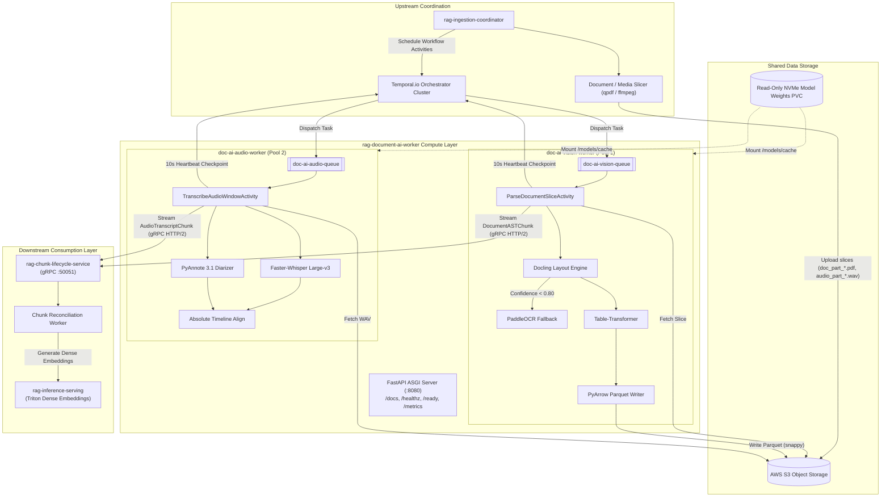
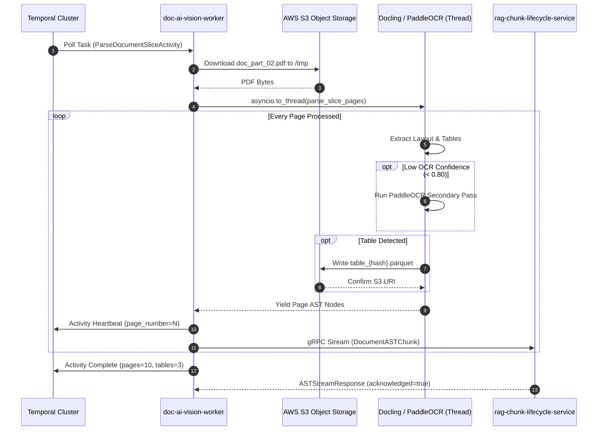
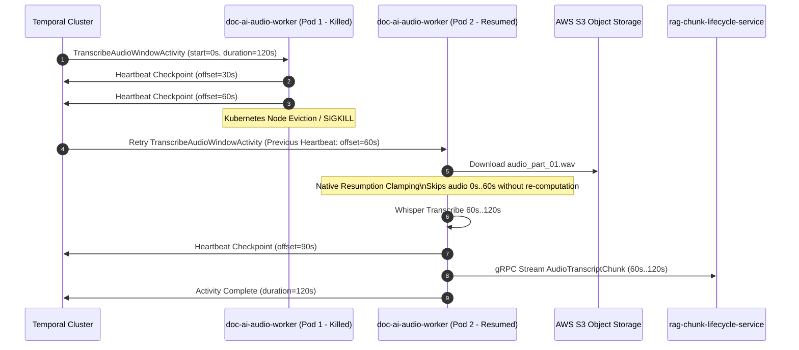
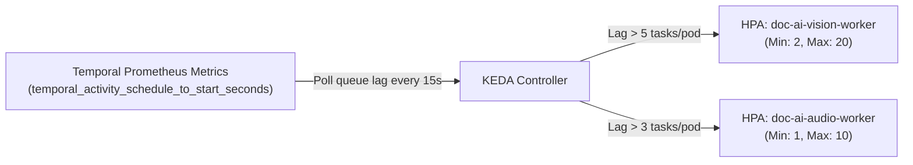

# System Architecture Specification: rag-document-ai-worker

## 1. Executive Summary & Microservice Identity

The **`rag-document-ai-worker`** is a high-throughput, horizontally scalable, stateless compute microservice purpose-built for enterprise Retrieval-Augmented Generation (RAG) ingestion pipelines. It processes complex physical document slices (PDFs) and progressive audio segments (WAV), extracting multimodal structures into rich Abstract Syntax Trees (ASTs), columnar Parquet tables, and absolute-timeline speaker-diarized transcripts.

### Decoupled Compute Worker Pools
To eliminate CUDA kernel interference, host memory leaks, and Out-of-Memory (OOM) failures arising from running heavy vision models and speech-to-text models within the same process space, `rag-document-ai-worker` strictly decouples into two isolated runtime worker pools:

1. **`doc-ai-vision-worker`** (`cmd/vision_worker`):
   - **Engine Stack**: Docling structural layout parsing, PaddleOCR multi-pass fallback, Table-Transformer detection, and PyArrow columnar Parquet extraction.
   - **Queue**: `doc-ai-vision-queue`
   - **Hardware Target**: 1x NVIDIA L4 / A10G (24 GiB VRAM), 4 vCPU, 8 GiB RAM.

2. **`doc-ai-audio-worker`** (`cmd/audio_worker`):
   - **Engine Stack**: Faster-Whisper large-v3 (CTranslate2), PyAnnote 3.1 speaker diarization, RIFF container validator, and absolute timeline projection engine.
   - **Queue**: `doc-ai-audio-queue`
   - **Hardware Target**: 1x NVIDIA L4 / A10G (24 GiB VRAM), 4 vCPU, 8 GiB RAM.

---

## 2. Distributed System Topology & Microservice Boundaries

`rag-document-ai-worker` does not operate in isolation; it functions as the compute-intensive ingestion core within an asynchronous, event-driven microservices ecosystem.

### End-to-End Microservice Architecture Diagram



### Microservice Responsibility Boundaries

| Microservice | Primary Responsibility | Interaction with `rag-document-ai-worker` |
| :--- | :--- | :--- |
| **`rag-ingestion-coordinator`** | Document ingestion API, raw file storage, document chunk pre-splitting (`qpdf`), and workflow lifecycle orchestration. | **Upstream**: Pre-splits files into discrete physical slices in S3 and dispatches activity tasks via Temporal. |
| **`rag-document-ai-worker`** *(This Service)* | Stateless GPU compute: visual AST layout parsing, table Parquet extraction, fallback OCR, speech transcription, speaker diarization. | **Core Compute**: Consumes tasks from Temporal, reads S3 slices, writes Parquet to S3, and streams ASTs via gRPC. |
| **`rag-chunk-lifecycle-service`** | AST node hierarchy mapping, parent-child token chunking, semantic boundary merging, chunk versioning, and reconciliation. | **Downstream**: Implements `DocumentAIChunkService` gRPC server receiving chunk streams from workers. |
| **`rag-inference-serving`** | NVIDIA Triton Inference Server hosting dense text/multimodal embedding models and cross-encoders. | **Indirect Downstream**: Consumes reconciled chunks from `rag-chunk-lifecycle-service` to generate vector embeddings. |

---

## 3. Five-Layer Internal Architecture

The internal codebase is architected into five decoupled layers adhering strictly to production engineering concepts:

```text
+-----------------------------------------------------------------------------------+
| Layer 1: API, Entrypoints & HTTP Probes (cmd/, internal/server/)                   |
+-----------------------------------------------------------------------------------+
                                         │
+-----------------------------------------------------------------------------------+
| Layer 2: Persistence, Data Models & S3 Storage (internal/storage/, api/proto/)    |
+-----------------------------------------------------------------------------------+
                                         │
+-----------------------------------------------------------------------------------+
| Layer 3: Orchestration, Concurrency & Thread Isolation (internal/temporal/)        |
+-----------------------------------------------------------------------------------+
                                         │
+-----------------------------------------------------------------------------------+
| Layer 4: Multimodal AI Inference Engines (internal/vision/, internal/audio/)      |
+-----------------------------------------------------------------------------------+
                                         │
+-----------------------------------------------------------------------------------+
| Layer 5: Security Sandboxing & Enterprise Observability (internal/config/)        |
+-----------------------------------------------------------------------------------+
```

### Layer 1: API, Entrypoints & HTTP Probes
- **Independent Binaries**: Dedicated entry points in `cmd/vision_worker/main.py` and `cmd/audio_worker/main.py` instantiate the respective compute pool, connect to Temporal, and run the background ASGI probe server.
- **Embedded ASGI Server**: Runs Uvicorn with a lightweight FastAPI application on port `8080`:
  - `GET /docs` & `GET /redoc`: Interactive OpenAPI 3.1 Swagger and ReDoc documentation.
  - `GET /api/docs` & `GET /openapi.json`: Machine-readable OpenAPI 3.1 JSON schemas.
  - `GET /healthz`: Kubernetes liveness probe checking event-loop responsiveness.
  - `GET /ready`: Kubernetes readiness probe verifying active Temporal connection and model cache readiness.
  - `GET /metrics`: Prometheus telemetry scrape endpoint.

### Layer 2: Persistence, Data Models & S3 Storage
- **Strict Statelessness**: Workers never maintain local databases or cross-task disk state. Local files are written strictly to ephemeral mounts (`/tmp`, `/dev/shm`) and cleaned immediately upon task completion.
- **Content-Addressed Parquet Tables**: Tabular structures are extracted, serialized into Apache Parquet with Snappy/Zstd compression, and uploaded directly to content-addressed S3 URIs:
  $$\text{s3\_uri} = \text{s3://}\{\text{bucket}\}/\text{artifacts}/\{\text{tenant\_id}\}/\{\text{doc\_hash}\}/\text{tables}/\{\text{table\_hash}\}.\text{parquet}$$
  *Advantage*: Eliminates large binary serialization across gRPC and Temporal payloads, providing immediate columnar analytics via DuckDB or Amazon Athena.

### Layer 3: Orchestration, Concurrency & Thread Isolation
- **The GIL Isolation Pattern**: Python's Global Interpreter Lock (GIL) is susceptible to starvation during intensive C++/CUDA operations (such as PyTorch layout inference, tokenization, or CTranslate2 beam search). 
- **Non-Blocking Thread Boundaries**:
  ```python
  # Offload synchronous neural inference to dedicated worker thread
  result = await asyncio.to_thread(self._engine.parse_slice_pages, ...)
  ```
- **Active Temporal Heartbeats**:
  - `HeartbeatRunner` executes continuously on the main `asyncio` event loop, emitting progress heartbeats every `10.0` seconds with page/offset checkpoints (`HEARTBEAT_INTERVAL_SECONDS`).
  - `HEARTBEAT_TIMEOUT_SECONDS` is set to `30.0` seconds (a 3x buffer) to withstand temporary GC pauses or batched GPU inference latency.
- **Mid-Window Checkpoint Recovery**:
  - If a worker pod is evicted or killed via `SIGKILL`, the subsequent retry activity receives the previous heartbeat checkpoint details (`VisionHeartbeatDetails.pages_completed` or `AudioHeartbeatDetails.offset_seconds`) and skips already processed pages/audio without re-computation or duplicate S3 writes.

### Layer 4: Multimodal AI Inference Engines

#### Vision Engine (`internal/vision/`)
1. **Physical Slices**: Ingests physical multi-page PDF segments (`start_page` through `start_page + page_count - 1`), avoiding unreliable byte-range HTTP reads.
2. **Docling Structural Parser**: Parses visual document layouts, segmenting elements into `paragraph`, `heading`, `table`, `list`, `code`, and `formula`.
3. **PaddleOCR Multi-Pass Fallback**: Any text block with a confidence score below `OCR_CONFIDENCE_THRESHOLD` (default: `0.80`) is dynamically re-routed to PaddleOCR for high-precision character recognition.
4. **Normalized Unit Coordinates**: All bounding boxes are transformed into canonical top-left unit coordinates ($[0.0, 1.0]$) regardless of underlying DPI:
   $$x_{\text{norm}} = \frac{x_{\text{pixel}}}{W_{\text{page}}}, \quad y_{\text{norm}} = \frac{y_{\text{pixel}}}{H_{\text{page}}}$$

#### Audio Engine (`internal/audio/`)
1. **Container RIFF Validation**: Fails fast with non-retryable `ApplicationError` on corrupt audio headers or non-standard sample rates before initiating heavy GPU inference.
2. **Faster-Whisper Large-v3**: Transcribes audio in progressive 30-second intervals (`AUDIO_PROGRESS_STEP_SECONDS`) with CTranslate2 `float16` precision, yielding word-level timestamps.
3. **PyAnnote 3.1 Diarization**: Performs neural speaker voiceprint clustering, identifying speaker turns and handling silence gaps.
4. **Absolute Timeline Projection (ADR-009)**:
   All timestamps are projected to the global media timeline using the window start offset:
   $$t_{\text{absolute}} = t_{\text{slice\_start}} + t_{\text{segment}}$$
   Guaranteeing seamless multi-window stitching in `rag-chunk-lifecycle-service`.

### Layer 5: Security Sandboxing & Enterprise Observability
- **Non-Root Execution**: Container images run under non-root UID `1000` with dropped Linux capabilities (`capabilities: drop: ["ALL"]`) and `readOnlyRootFilesystem: true`.
- **Ephemeral Storage Quotas**:
  - `/dev/shm`: 2 GiB memory-backed `emptyDir` for PyTorch inter-process communication.
  - `/tmp`: 4 GiB `emptyDir` for temporary slice decoding.
- **Secured Structlog Redaction**:
  - Custom `secured_logging_filter` automatically intercepts and sanitizes log event dictionaries.
  - Document text, OCR tokens, transcripts, customer PII/PHI, auth headers, and presigned S3 URLs are scrubbed and replaced with `[REDACTED]`.
- **Structured JSON Logs**: In `staging` and `production`, logs output single-line JSON with distributed trace correlation context: `tenant_id`, `document_id`, `task_queue`, `activity_id`, `page_number`.

---

## 4. Inter-Service Communication Contracts

### A. Temporal Activity Contracts

#### Vision Activity: `ParseDocumentSliceActivity`
```json
// Input: ParseDocumentSliceInput
{
  "tenant_id": "tenant-prod-42",
  "document_id": "doc-98214",
  "doc_hash": "a1b2c3d4e5f6...",
  "s3_bucket": "rag-doc-ai-storage-prod",
  "s3_key": "slices/tenant-prod-42/a1b2c3d4e5f6/doc_part_02.pdf",
  "start_page": 20,
  "page_count": 10
}

// Output: ParseDocumentSliceOutput
{
  "pages_processed": 10,
  "table_count": 3,
  "parquet_s3_uris": [
    "s3://rag-doc-ai-storage-prod/artifacts/tenant-prod-42/a1b2c3d4e5f6/tables/t1.parquet",
    "s3://rag-doc-ai-storage-prod/artifacts/tenant-prod-42/a1b2c3d4e5f6/tables/t2.parquet"
  ]
}
```

#### Audio Activity: `TranscribeAudioWindowActivity`
```json
// Input: TranscribeAudioWindowInput
{
  "tenant_id": "tenant-prod-42",
  "media_id": "media-11029",
  "doc_hash": "f6e5d4c3b2a1...",
  "s3_bucket": "rag-doc-ai-storage-prod",
  "s3_key": "slices/tenant-prod-42/f6e5d4c3b2a1/audio_part_01.wav",
  "start_offset_seconds": 0.0,
  "duration_seconds": 600.0,
  "min_speakers": 1,
  "max_speakers": 4
}

// Output: TranscribeAudioWindowOutput
{
  "audio_duration_seconds": 600.0,
  "segments_transcribed": 84,
  "speakers_detected": 3,
  "transcription_rtf": 0.082
}
```

### B. gRPC Streaming Contract (`DocumentAIChunkService`)

Defined in `api/proto/v1/document_ai.proto`, the worker streams extracted structures directly to `rag-chunk-lifecycle-service` over HTTP/2:

```protobuf
syntax = "proto3";
package rag.document_ai.v1;

import "api/proto/v1/common.proto";

service DocumentAIChunkService {
  rpc StreamDocumentAST(stream DocumentASTChunk) returns (ASTStreamResponse);
  rpc StreamAudioTranscript(stream AudioTranscriptChunk) returns (ASTStreamResponse);
}

message DocumentASTChunk {
  string tenant_id = 1;
  string document_id = 2;
  int32 page_number = 3;
  repeated ASTNode nodes = 4;
}

message ASTNode {
  string node_id = 1;
  string node_type = 2;         // "paragraph", "heading", "table", "list", etc.
  string text_content = 3;      // Text content or Markdown summary
  rag.common.v1.BoundingBox bounding_box = 4;
  string table_parquet_s3_uri = 5; // Populated only if node_type == "table"
}

message AudioTranscriptChunk {
  string tenant_id = 1;
  string audio_id = 2;
  repeated TranscriptSegment segments = 3;
}

message TranscriptSegment {
  string speaker_id = 1;
  double start_time_seconds = 2; // Absolute timeline timestamp
  double end_time_seconds = 3;   // Absolute timeline timestamp
  string text = 4;
  repeated WordTimestamp words = 5;
}
```

---

## 5. End-to-End Processing Flows

### Vision Slicing & AST Egress Sequence



### Chaos & Preemption Resumption Sequence



---

## 6. Infrastructure, Autoscaling & Deployment Topology

### Autoscaling with KEDA (`ScaledObject`)
The workers scale dynamically based on Temporal activity backlog latency and queue depth:



### Model Caching Architecture
- Model weights are pre-baked onto high-performance NVMe storage and mounted to all worker pods as a **read-only PersistentVolumeClaim** (`doc-ai-model-weights-nvme-pvc`) at `/models/cache`.
- Subdirectories map cleanly to each engine:
  - Hugging Face Transformers & PyAnnote: `/models/cache/huggingface`
  - PyTorch Hub: `/models/cache/torch`
  - Docling Layout Artifacts: `/models/cache/docling`
  - Faster-Whisper / CTranslate2: `/models/cache/whisper`
- Pod startup is near-instantaneous ($< 5\text{s}$) because weights are memory-mapped directly from local NVMe storage without runtime internet dependencies.

### Memory Optimization Invariants
- **`jemalloc` Allocator**: Injected via `LD_PRELOAD=/usr/lib/libjemalloc.so` in container images to eliminate glibc arena fragmentation, stabilizing memory over thousands of consecutive inference executions.
- **`PYTORCH_CUDA_ALLOC_CONF=max_split_size_mb:128`**: Configures PyTorch's native caching allocator to eliminate virtual memory fragmentation in long-running GPU processes.
- **Thread Concurrency Limits**: `OMP_NUM_THREADS=2` and `OPENBLAS_NUM_THREADS=2` prevent CPU thread pool contention with the Python `asyncio` event loop.

---

## 7. Key Operational SLOs & Alerting Thresholds

| Metric / Objective | Target SLO | Prometheus Alert Rule | Action |
| :--- | :--- | :--- | :--- |
| **Vision Latency** | $\le 2.0\text{s}$ per page | `QueueBacklogGrowth` | Triggers KEDA horizontal scale-out. |
| **ASR Latency** | $\text{RTF} \le 0.15$ | `QueueBacklogGrowth` | Triggers KEDA horizontal scale-out. |
| **Temporal Heartbeat** | Emitted every $10\text{s}$ ($\le 30\text{s}$) | `ActivityHeartbeatTimeout` | Automatically retries task on fresh pod. |
| **CUDA OOM Errors** | $0$ errors per 2,000 tasks | `CudaOOMErrors` (P1 Page) | Immediate alerts on-call engineer. |
| **Activity Failure Rate**| $< 0.1\%$ | `ActivityFailuresHigh` (P2 Alert) | Triggered when failure rate $> 2\%$ over 10m. |
