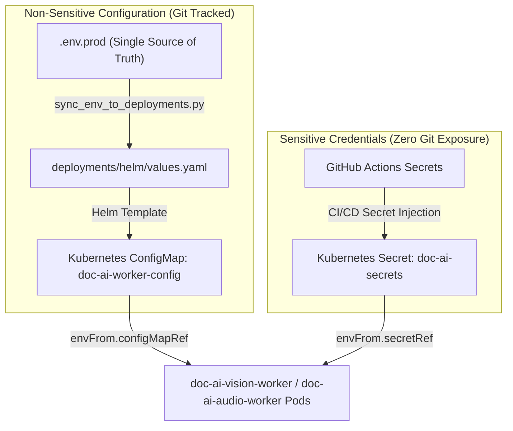
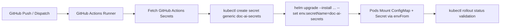

# Secret Management & CI/CD Secret Injection

This document describes the secret management architecture, credential isolation invariants, and automated CI/CD secret injection pipeline for the `rag-document-ai-worker` microservice.

---

## 1. Architectural Model: ConfigMap vs. Secret Decoupling

To prevent credential leakage and satisfy enterprise security compliance (SOC 2, ISO 27001), runtime configuration is strictly partitioned into two layers:



1. **Non-Sensitive Configurations (Kubernetes ConfigMap)**:
   - Sourced directly from [`.env.prod`](file:///c:/Users/ANIK/Desktop/Gemejime/Document%20AI%20Parsers/.env.prod).
   - Synchronized to [`deployments/helm/values.yaml`](file:///c:/Users/ANIK/Desktop/Gemejime/Document%20AI%20Parsers/deployments/helm/values.yaml) via `python scripts/sync_env_to_deployments.py --sync`.
   - Enforced by pre-commit hooks and GitHub Actions CI drift verification (`--check-only`).
   - Pods restart automatically via `checksum/config` sha256 annotation in [`deployments/helm/templates/deployment.yaml`](file:///c:/Users/ANIK/Desktop/Gemejime/Document%20AI%20Parsers/deployments/helm/templates/deployment.yaml).

2. **Sensitive Credentials (Kubernetes Secret)**:
   - Never stored in `.env.prod`, `values.yaml`, or Git history.
   - Automatically excluded by [`scripts/sync_env_to_deployments.py`](file:///c:/Users/ANIK/Desktop/Gemejime/Document%20AI%20Parsers/scripts/sync_env_to_deployments.py) matching keywords: `PASSWORD`, `SECRET`, `TOKEN`, `KEY`.
   - Injected dynamically at deployment time via GitHub Actions ([`.github/workflows/deploy.yml`](file:///c:/Users/ANIK/Desktop/Gemejime/Document%20AI%20Parsers/.github/workflows/deploy.yml)) into the Kubernetes cluster.
   - Injected into the container via `envFrom.secretRef` pointing to `doc-ai-secrets`.

---

## 2. GitHub Actions Secrets Inventory

Configure the following secrets in **GitHub Repository Settings &rarr; Secrets and variables &rarr; Actions**:

| Secret Name | Purpose | Target Microservice Env Variable |
| :--- | :--- | :--- |
| `KUBECONFIG` | Base64 or raw kubeconfig granting deployment access to target cluster | *Deployment context only* |
| `PROD_HF_TOKEN` | Hugging Face token for downloading gated PyAnnote Diarization models (`pyannote/speaker-diarization-3.1`) | `HF_TOKEN` |
| `PROD_AWS_ACCESS_KEY_ID` | Storage access key for AWS S3, MinIO, or Cloudflare R2 | `AWS_ACCESS_KEY_ID` |
| `PROD_AWS_SECRET_ACCESS_KEY` | Storage secret key for AWS S3, MinIO, or Cloudflare R2 | `AWS_SECRET_ACCESS_KEY` |

---

## 3. Automated Injection Flow (`.github/workflows/deploy.yml`)

When code merges into `main`, `master`, or `rag-document-ai-worker`:



### Injection Command:
```bash
kubectl create secret generic doc-ai-secrets \
  --namespace doc-ai \
  --from-literal=HF_TOKEN="${{ secrets.PROD_HF_TOKEN }}" \
  --from-literal=AWS_ACCESS_KEY_ID="${{ secrets.PROD_AWS_ACCESS_KEY_ID }}" \
  --from-literal=AWS_SECRET_ACCESS_KEY="${{ secrets.PROD_AWS_SECRET_ACCESS_KEY }}" \
  --dry-run=client -o yaml | kubectl apply -f -
```

---

## 4. Pod-Level Consumption

In [`deployments/helm/templates/deployment.yaml`](file:///c:/Users/ANIK/Desktop/Gemejime/Document%20AI%20Parsers/deployments/helm/templates/deployment.yaml):
```yaml
containers:
  - name: {{ .Chart.Name }}
    envFrom:
      - configMapRef:
          name: {{ include "rag-document-ai-worker.fullname" . }}-config
      {{- if and .Values.env .Values.env.secretName }}
      - secretRef:
          name: {{ .Values.env.secretName }}
      {{- end }}
```

When `env.secretName` is set to `doc-ai-secrets`, Kubernetes injects all secret keys directly into the process environment without exposing their values in manifests or log output.

---

## 5. Alternative Enterprise Injection Patterns

### A. AWS IRSA (IAM Roles for Service Accounts)
When running on AWS EKS, static storage credentials (`AWS_ACCESS_KEY_ID` and `AWS_SECRET_ACCESS_KEY`) can be entirely eliminated by annotating the Kubernetes `ServiceAccount`:
```yaml
# deployments/helm/values.yaml
serviceAccount:
  create: true
  annotations:
    eks.amazonaws.com/role-arn: arn:aws:iam::123456789012:role/doc-ai-s3-rw-role
```
The AWS SDK in `S3StorageClient` will automatically retrieve temporary credentials via STS Web Identity token files mounted by Kubernetes.

### B. External Secrets Operator (ESO) & HashiCorp Vault
In multi-tenant or enterprise environments utilizing HashiCorp Vault, AWS Secrets Manager, or GCP Secret Manager, deploy an `ExternalSecret` resource to synchronize `doc-ai-secrets` automatically without CI/CD pipeline access to raw secret values:
```yaml
apiVersion: external-secrets.io/v1beta1
kind: ExternalSecret
metadata:
  name: doc-ai-secrets
  namespace: doc-ai
spec:
  refreshInterval: "1h"
  secretStoreRef:
    name: vault-backend
    kind: ClusterSecretStore
  target:
    name: doc-ai-secrets
    creationPolicy: Owner
  data:
    - secretKey: HF_TOKEN
      remoteRef:
        key: secret/data/doc-ai
        property: hf_token
    - secretKey: AWS_ACCESS_KEY_ID
      remoteRef:
        key: secret/data/doc-ai
        property: aws_access_key_id
    - secretKey: AWS_SECRET_ACCESS_KEY
      remoteRef:
        key: secret/data/doc-ai
        property: aws_secret_access_key
```

---

## 6. Secret Rotation & Zero-Downtime Rollout

1. **Rotate Credentials in Secret Provider**:
   - Update the secret value in GitHub Actions Secrets or Vault.
2. **Re-run Injection**:
   - Re-running the GitHub Actions deploy workflow updates the Kubernetes `doc-ai-secrets` Secret object.
3. **Trigger Rolling Restart**:
   - Trigger a rolling update across worker deployments:
     ```bash
     kubectl rollout restart deployment/doc-ai-vision-worker -n doc-ai
     kubectl rollout restart deployment/doc-ai-audio-worker -n doc-ai
     ```
   - Kubernetes gracefully terminates old pods after new pods pass `/ready` HTTP probe checks on port 8080.
